# Grab

A small Mac app for [yt-dlp](https://github.com/yt-dlp/yt-dlp). Paste a link, press Return, done.

- Video up to 4K or audio only (M4A, MP3, Opus, FLAC, WAV)
- Playlists, search, Spotify and Apple Music links
- Converts video and audio files on your Mac
- Installs and updates yt-dlp, ffmpeg and Deno on its own

Public videos only: Grab doesn't use browser cookies.

## Requirements

macOS 26 or later, Apple silicon.

## Install

Download `Grab.zip` from the latest release, unzip it and move `Grab.app` to `/Applications`.
